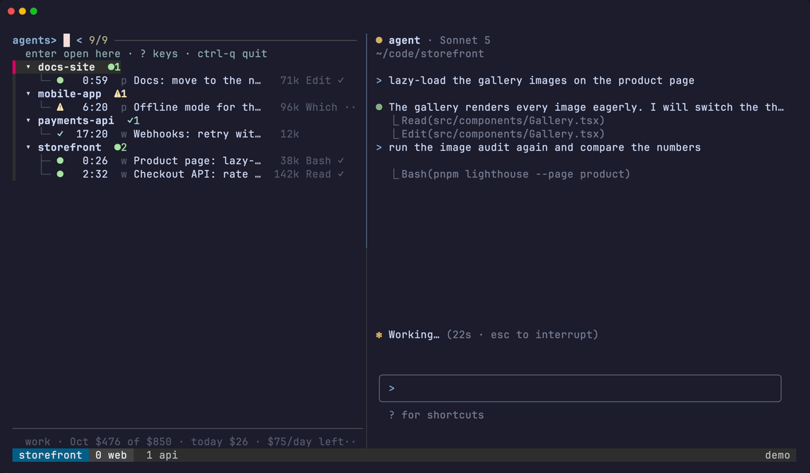
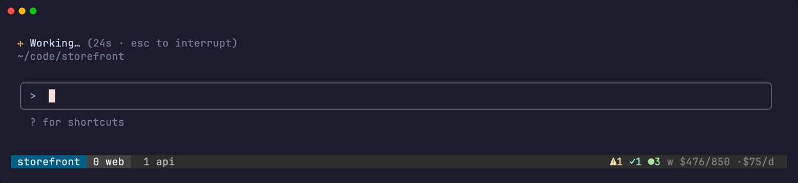

<div align="center">

# tagents

**Know which Claude Code session needs you, without leaving tmux.**

[Docs](https://tagents.arstoien.com/docs/) · [Install](#install) · [Getting started](https://tagents.arstoien.com/docs/guide/getting-started) · [Resurrect](#never-lose-a-session)



</div>

tagents is a live dashboard for every Claude Code chat you run in tmux: what each one is doing, which one is waiting on you, how much context it holds and what it has spent. Pick a row and the chat opens right beside the list, so you can answer it and move on.

It grew up in parallel to [herdr](https://herdr.dev), around the same idea, for people who would rather keep tmux: no new multiplexer, no new terminal, and your own config and key bindings stay yours.

---

## What it does

- **Shows who is waiting on you.** A chat stuck on a question or a permission turns `BLOCKED` and is counted in its project's header, so nothing waits unnoticed in a window you are not looking at.
- **Taps you on the shoulder.** A desktop notification when a chat asks something, wants a permission or finishes its turn; click it and you land in that chat.
- **The chat beside the list.** The dashboard is a tmux session of its own: `enter` on a row shows that chat on the right, and `ctrl-g` takes your terminal to where it lives.
- **Survives a reboot.** Close the laptop, restart, kill the tmux server: every chat comes back in its window, on its account, with its model.
- **Forgets nothing.** Closed chats stay one keystroke away, with their last prompts, and resume where they ran.
- **Keeps your accounts apart.** Work and personal Claude logins, chosen per directory, with a badge on every row so you always know which one is paying.
- **Counts the cost.** Context size and spend per chat, what each project burned in the last five hours, and the month so far against your plan's limit.

---

## Install

```sh
curl -fsSL https://raw.githubusercontent.com/SkuratovichA/tagents/main/install.sh | sh
```

It puts one managed copy in `~/.local/share/tagents`, the commands in `~/.local/bin` and the Claude Code hooks in `~/.claude/hooks`. Run it again, or `tagents update`, to update. Needs `tmux`, `fzf`, `jq`, `git`, Node 22.18+ and `pnpm`.

### Compatibility

| | macOS | Linux |
|---|---|---|
| Prebuilt `tagents-core` | `aarch64-apple-darwin`, `x86_64-apple-darwin` | `x86_64-unknown-linux-musl` |
| Any other system | the node CLI runs in place of the binary | the node CLI runs in place of the binary |
| CI runs the Rust crates on | `macos-latest` | `ubuntu-latest` |

| needs | version |
|---|---|
| Node | 22.18 or newer (`engines` of `package.json`); CI uses the 22.23.1 of `.node-version` |
| bash | 3.2, which is what macOS ships: the scripts are written for it |
| tmux | no minimum is stated; developed and measured on 3.7b; the popup call is written to work on 3.4 as well |
| fzf | no minimum is stated; developed on 0.74 |
| `jq`, `awk`, `git`, `pnpm` | no minimum is stated; `packageManager` pins `pnpm` 9.15.4 |

The installer checks the SHA-256 sum of a prebuilt binary and falls back to the node CLI on any other machine. `--launchd`, the daily update, is macOS only.

The install ends by running `tagents setup` (on a first install, and on an update that changes what it registers), which adds the state hook and the status line to `~/.claude/settings.json`, and to the `settings.json` of `$CLAUDE_CONFIG_DIR` and of each profile's `config_dir`. It only appends: your own hooks and settings stay as they are, a file it changes is backed up first, and a file that is not valid JSON is refused and left untouched. A status line of your own is kept, and the message says how to switch (`tagents setup --statusline`). `tagents setup --check` shows what it would add and writes nothing.

The hook is how a chat tells tagents what it is doing; the status line is where the model column comes from. [Getting started](https://tagents.arstoien.com/docs/guide/getting-started) walks through both, and the Claude Code plugin.

---

## Start

```sh
tagents
```

That is the whole first run, inside any tmux session. Every Claude chat with the hook shows up on its own, whether tagents started it or you typed `claude` in a pane yourself.

Press **`?`** for every key. Pick one from the list and `enter` runs it, so there is nothing to memorise, and the keys are yours to move in the config.


---

## Notifications

<p align="center">
  
</p>

```sh
tagents plugin add ~/.local/share/tagents/packages/notify
tagents notify install
```

macOS asks once whether tagents may notify you. After that, a question, a permission prompt or a finished turn raises a banner, and a click opens that chat beside the list. A chat you are already looking at stays quiet, a notice that no longer applies is taken back, and an idle chat warns you before its prompt cache expires. [More on notifications](https://tagents.arstoien.com/docs/guide/notifications)

---

## Never lose a session


tmux-resurrect and tmux-continuum bring back your sessions, windows and splits, but a chat comes back as an empty shell: they cannot know which conversation it was. tagents remembers, and resumes each one in its place, on the account it ran on, with its model and its window name.

Add two lines to `~/.tmux.conf`, after the tmux-resurrect settings:

```tmux
set -g @resurrect-hook-post-save-layout '~/.local/bin/tagents --resurrect-save'
set -g @resurrect-hook-post-restore-all '~/.local/bin/tagents --resurrect --auto'
```

Without tmux-resurrect it still works: `tagents --resurrect` rebuilds what is missing. [How resurrect works](https://tagents.arstoien.com/docs/guide/resurrect)

---

## Several sessions, several accounts


Every tmux session is a group and every chat a row. A small optional config at `~/.config/tagents/config.toml` decides which Claude login a new chat starts on:

```toml
[claude.profiles.personal]
config_dir = "~/.claude-personal"

[claude.profiles.work]          # the default ~/.claude

[[claude.rules]]
dir = "~/git/personal"
profile = "personal"

[[claude.rules]]
dir = "~/git/work"
profile = "work"

[usage]
watch = "work"                  # show context and cost for this login
```

Nothing is required: without a config every chat starts exactly as plain `claude` would. [The whole config](config.example.toml) · [Accounts](https://tagents.arstoien.com/docs/guide/accounts) · [Cost](https://tagents.arstoien.com/docs/guide/cost)

For the tmux status bar, a one-line tally of your chats by state:

```tmux
set -g status-right '#{?@tagents_counts,#{@tagents_counts},#(~/.local/bin/tagents --counts)}'
```



---

## Claude Code plugin

```
/plugin install tagents --marketplace SkuratovichA/tagents
```

Gives every chat the `tagents` skill, so it knows the exact commands and flags of tagents instead of guessing, and a `knowledge` MCP server that searches your markdown notes. [About the plugin](https://tagents.arstoien.com/docs/guide/claude-code-plugin)

---

## Learn more

The [docs](https://tagents.arstoien.com/docs/) cover the rest: [the dashboard](https://tagents.arstoien.com/docs/guide/dashboard) · [notifications](https://tagents.arstoien.com/docs/guide/notifications) · [resurrect](https://tagents.arstoien.com/docs/guide/resurrect) · [closed sessions](https://tagents.arstoien.com/docs/guide/closed-sessions) · [accounts](https://tagents.arstoien.com/docs/guide/accounts) · [cost](https://tagents.arstoien.com/docs/guide/cost) · [notes](https://tagents.arstoien.com/docs/guide/notes) · [keys](https://tagents.arstoien.com/docs/guide/keys) · [architecture](https://tagents.arstoien.com/docs/architecture/overview) · [development](https://tagents.arstoien.com/docs/development)

## License

MIT, see [LICENSE](LICENSE).
