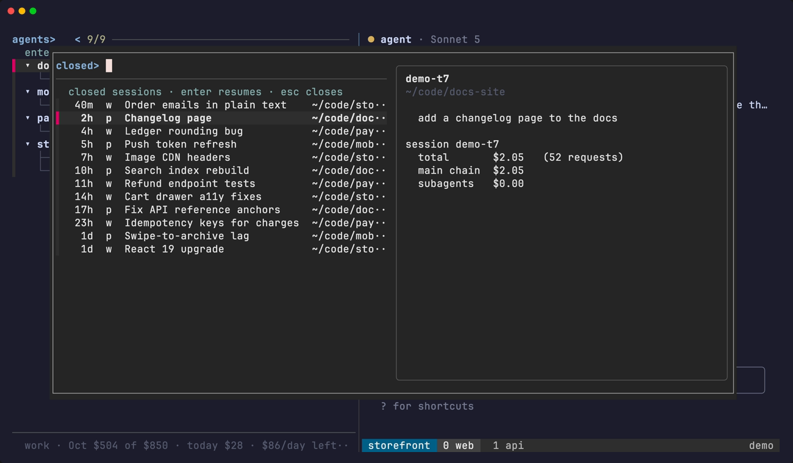

# Closed sessions

Every conversation you have had stays reachable. `ctrl-y` opens a picker of the sessions that are **not** running, newest activity first, and `enter` resumes the one you pick. It is how you get back to something you closed last week.

## The picker

- **Order**: newest activity first.
- **Name**: the name this dashboard knows the session by, which is the one you typed with `ctrl-r`, else the one `$TA_LABEL` announced at launch, else the session's first prompt, else its bare id.
- **Preview**: the last ten prompts of that conversation, the directory it ran in, and what it cost when `tusage` still has it.
- **`enter`** resumes the one you pick, on the account it actually ran on and in the tmux session that owns its project.
- **`esc`** closes the picker without doing anything.

## Where it comes from

Nothing here is a new store. Two files that were already being written are joined by session id:

- `$STATE_DIR/history.tsv`, which the state hook appends a line to on every session start, turn end and session end.
- Each account's own `<config dir>/history.jsonl`, which has a line per prompt typed into it.

The file a prompt is in is also the answer to which login can resume the session, which is why the account column can be trusted.

A session is browsable for as long as *either* file remembers it. The directory a resume starts in is the last one the hook recorded, falling back to the prompt log's project, and to `$HOME` when that directory is gone.

## Closed rows in the list

The closed rows *inside* the list are a different thing and still expire after 24 hours (`DEAD_TTL`, set with `TA_DEAD_TTL` in seconds). Those are panes whose state record is still around, offered where you last saw the agent.

`tagents --closed-rows` prints the machine-readable table the picker is built from.

Child sessions are never offered here; see [States and order](./states#child-sessions).
