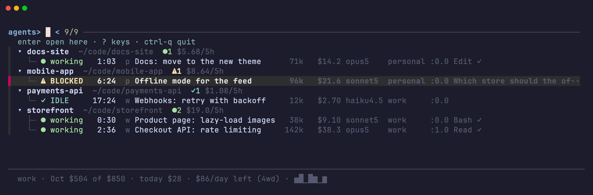
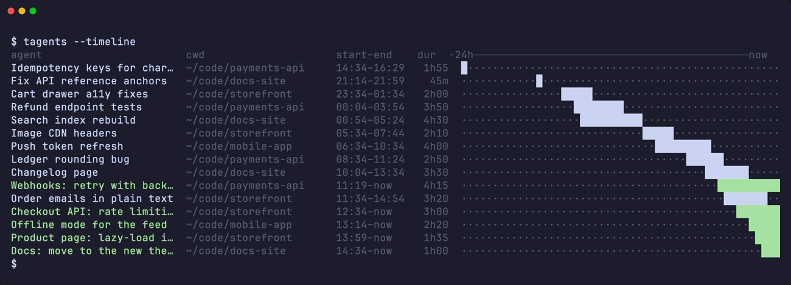
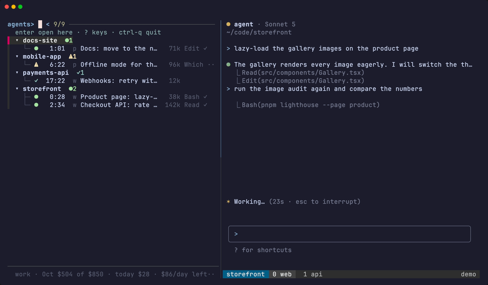

# The dashboard

The dashboard is a list of every Claude Code session under tmux: what each one is doing, which is blocked on you, how much context it holds and what it has spent. It lives in a tmux session of its own, `tagents`, with the list on the left and the chat you select shown on the right, so you can type into that chat without leaving the dashboard.



## Reading the list

Sessions are grouped by project. Each group has a header, and each session is a row under it:

```
▾ .dotfiles    ~/git/.dotfiles           ●1
  └─ ● working   0:31  p dotfiles   71k  $44.0  opus5    personal  %3
▾ storefront   ~/git/storefront          ⚠1 ✓1 ●1   $31.4/5h
  ├─ ● working   0:08  w web        38k   $9.1  sonnet5  work      %44  ⑂2
  ├─ ⚠ BLOCKED   2:14  w api       142k  $38.3  opus5    work      %31
  └─ ✓ IDLE     17:02  w worker     12k   $2.7  haiku4.5 work      %12
```

### The columns, left to right

| column | what it says |
|--------|--------------|
| state | `⚠ BLOCKED`, `✓ IDLE`, `● working` and the others; see [States and order](./states) |
| time | how long since **you** last typed into that session. It doubles as the clock of the one-hour prompt cache, see [States and order](./states#the-clock-the-rows-are-sorted-on) |
| badge | one or two characters naming the Claude login the session is on |
| name | the label you gave it with `ctrl-r`, else the title the session gave itself |
| context | how much context the session is holding (`71k`) |
| cost | what the session has spent, see [Cost](./cost) |
| model | the model the session is set to now |
| account | the full name of the login, when there is room for it |
| pane | the tmux pane id (`%3`), or `headless` or `child` for a session with no pane of its own |

A group header carries the project's directory, a tally of its states (`⚠1 ✓1 ●1`) and, when cost is on, the project's `/5h` burn (`$31.4/5h`), an estimate. `⑂2` after a row is the number of subagents the session has running.

### Badge and account

Both say which Claude login the session is on, named after the profile in your [config](./accounts) that claims its `CLAUDE_CONFIG_DIR`.

- The **account** name appears when the list has room for it.
- The **badge** is one or two characters and is on every row at every width: `p`, `w`, the first letter of the profile name unless `badge:` says otherwise. More than two characters are clipped to two, since the column is as wide as the widest of them.
- Both stay blank for a session whose state record predates them, rather than guessing.
- With no profiles configured, the badge column does not exist at all.

### How wide the columns are

Every column is as wide as the widest thing it has to say. A column with nothing to say on any row takes no room at all: with no usage tracked there is no context or cost column, and the width goes to the detail. Columns are let in one at a time, in the order of what they answer: the context size first, which decides between going on and `/compact`, then the cost, the state word, the project of a flat row, the location, the model and the account. Each one comes in only while the detail keeps ten columns, or all of its widest line when that is shorter, so the last tool line is never squeezed out, and a column that does not fit is skipped while a narrower one after it may still come in.

The context and cost figures and the state word keep their full width whenever they are drawn, so a figure growing a digit never shifts the columns after it. The state word is let in only while the longest name can still grow to its full width beside it, since the glyph's colour already says the state: on a narrow list with long names, the name wins. The badge is shown at every width. The order the columns are drawn in never changes, and a column you hide with `ctrl-w` is never let back in.

### How a project is chosen

Agents are grouped by the directory they were **launched** in, not their current one. The hook reports a live working directory that follows the Bash tool's `cd`, and grouping on it made sessions hop between projects while you watched. The launch directory is recovered from the first `cwd` in the transcript and cached per session id.

A session counts as **running** only when a Claude process really is alive in that pane, checked against the process tree; a state file alone proves nothing. Panes whose Claude has exited are listed as closed, and `enter` resumes them on the account they ran on.

## Moving around

`enter` on a row selects it: the viewport on the right shows that chat's window with the chat's pane active, and you stay on the dashboard. On a dimmed window row it selects the window, on a closed row it resumes the session first, and on a group header it shows that session's last-used window.

`ctrl-g` takes your terminal itself to where the chat lives: it switches to the chat's own session, selects its window and pane, and so leaves the dashboard. On a group header it goes to that session's own selected window. It never resumes: on a closed row it only says that `enter` resumes it, and it says `tagents: that window is gone` when the window has closed. `ctrl-e` types a line straight into an agent without leaving the list.

`$` opens the month's usage per day. With `usage.watch` unset it opens nothing and says `tagents: usage is off — set usage.watch to the profile to track`.

A few more act on the list itself: `ctrl-t` switches between tree and flat, `ctrl-l` refreshes now, `ctrl-r` names an agent (`F2` too) and `ctrl-q` quits. Every key can be moved, and `?` lists them all; see [Keys](./keys).

### The preview

`ctrl-v` opens the preview in a modal window of its own: the cost per subagent and the tail of the transcript. It scrolls, and `q` closes it. With no `less` on `$PATH` it is printed instead and any key closes it. In the `prefix+a` popup, and on a tmux with no popups at all, the preview stays fzf's own preview beside the list, because a popup cannot open a second popup.

### The timeline

```sh
tagents --timeline
```

Who worked when over the last day, as bars. A child session's hours are drawn with a `↳`.



## Windows and sessions

A row is a tmux window and a group is a tmux session. Every session is a group, whether or not a chat has ever run in it, except the dashboard's own session `tagents`, which is never a group.

`enter` points the viewport at the chosen window; no pane moves. Anything the window holds, such as a shell, a dev server or a notes editor, is yours: tagents never moves, resizes or kills it, and it leaves the screen with the window and comes back with it.

### The cursor follows the viewport

tmux's own switches made in the viewport (`prefix n`, `prefix s`, a click on its status bar) fire `session-window-changed` and `client-session-changed`. tagents hooks both with `tagents --follow`, which moves the list's cursor onto the row of the window the viewport now shows. It moves nothing else, and does nothing when the dashboard is not up.

### Two chats side by side

`ctrl-s` joins another chat's pane into the window on screen, to the right of its chat. The pane remembers its home session, and `ctrl-u` breaks it out into a window of its own.

A window with no chat in it is listed as a dimmed row, and `enter` on it selects the window.

### Starting new chats



| key | what it starts |
|-----|----------------|
| `ctrl-n` | a new agent in the project under the cursor |
| `ctrl-p` | the same, but you choose the Claude account by hand, whatever the rules say |
| `ctrl-a` | a plain shell in a new window of the session under the cursor, in the row's directory |

All three also work on a session header with no row under it, which is how you open the first window there. Which account an agent starts on is decided by your [configuration](./accounts).

### Closing things

Closing a chat's pane or window is plain tmux: there are no seats and no placeholders, so `prefix+x` and `prefix+&` need no binding of tagents' own.

- `ctrl-x` on a chat hangs up its Claude and closes its pane, after asking. The dashboard is never in that window, so it stays as it is.
- `ctrl-x` on a row that is already closed forgets it.
- `ctrl-x` on a dimmed window row asks about the whole window, listing its panes, and closes it with all of them. When it was the last window of its session, the session ends with it, and the question says so.

A layout saved by an earlier version can bring back idle shells titled `tagents-sidebar` where the list used to sit; `tagents --resurrect` closes those shells after the restore.

## Windows are named after their agents

The dashboard is one way to find an agent. `prefix+w`, the status bar and `tmux ls` are the other, and they work when the dashboard is not on screen, so the tmux window an agent lives in is named after that agent.

- **The name is the one the list shows**: the label you gave it with `ctrl-r`, or the session's terminal title (what Claude's `/rename` sets) when you have not. Never the directory, since tmux's own `automatic-rename` already names a window after what is running in it.
- **When it renames**: within about ten seconds of the name changing while the dashboard is up, and within thirty when it is not. The status bar runs the same pass, throttled, so this works with no dashboard open at all.
- **A window several agents share** is named after the one with the newest activity. Panes with no name to give are not candidates, so a shell split off beside an agent never takes the window's name.
- **A name you typed is never overwritten.** A window is only renamed when its current name is tmux's automatic one, or the name tagents itself gave it last time (recorded in the window option `@tagents_name`). Rename a window by hand and nothing here touches it again, until the day its name coincides with one of those two.
- The dashboard's own window is never named.

`tagents --sync-names` runs one pass by hand, which is the way to see what it would do.

## Hiding columns

`ctrl-w` opens a small window with a checkmark per column: `badge`, `ctx`, `cost`, `model`, `acct`, `loc`. `enter` toggles the one under the cursor and the list behind reloads immediately. The picker stays open; `esc` closes it.

Hiding `cost` takes **every** figure in dollars with it: the column, the `⑂` subagent share and the project header's `/5h` total. Money you are not currently spending against a limit is the distraction this exists for. The subagent *count* (`⑂2`) is not money and stays. Nothing is ever reordered: the freed width goes to the detail column, exactly as it does when the pane itself is narrow.

What is hidden lives one key per line in `$STATE_DIR/cols`, so it survives a restart.

- `TA_HIDE_COLS=cost,model tagents` overrides that file for a single run.
- `tagents --hidden-cols` prints what is in force.

## The cockpit

The dashboard is a tmux session of its own, named `tagents`. The list is its left pane at `TA_WIDTH` percent (45 by default), and the right pane, the **viewport**, is a second client of the same tmux server that shows the window you select, so no pane ever moves between windows. There is no other layout and no config key for it: a `dashboard.layout` line left in an old config is ignored.

- `tagents`, typed in any pane, and `tagents --ensure-dash` make the cockpit if it is not up, point the viewport at the window you were in and switch your terminal to it. The shell you typed it in gets its prompt back.
- `enter` on a row points the viewport at that row's window.
- A selection made for a terminal that is attached elsewhere (a popup, a notification click) points the viewport the same way. The popup also brings that terminal to the session `tagents`.
- A list or a viewport that is killed comes back within about a second.
- A session that is already named `tagents` and is not a dashboard stops the cockpit with a message: rename it, and the dashboard can start.

### Keys and the prefix in the cockpit

The session `tagents` has no prefix of its own. The list keeps its keys (`ctrl-n`, `ctrl-s` and the rest work as before), and your tmux prefix, typed in the list, is sent on to the viewport, which becomes the active pane. So `prefix c` opens a window in the session the viewport shows, and `prefix d` detaches your terminal and leaves the viewport attached to the session it showed, ready for the next `tmux attach -t tagents`. The mouse bindings of the root table that do not open a menu work in the list too. Messages and popups appear on the viewport's client, because the dashboard's own status line is off.

Root bindings (`bind -n …`) do not fire while the list is the active pane; they do in the viewport, where they act in the window it shows. Press the prefix first or click into the viewport.

`ctrl-q` in the list is the way out. It shows your terminal the window the viewport showed, removes the key table, the hook and the options the cockpit set, and closes the session `tagents`; every other terminal attached to it moves to that window too.

::: tip Measured on one tmux
The cockpit is measured on tmux 3.7b only.
:::

### The cockpit and resurrect

The resurrect snapshot files the dashboard under the window the viewport showed (`D`, `work`, `2`, never the session `tagents`). `tagents --resurrect` brings the cockpit back with its viewport on that window and leaves your terminal where it is. A session `tagents` that tmux-resurrect left as two idle shells titled `tagents-sidebar` and `tagents-viewport` is rebuilt in place, without detaching anyone, before the dashboard is restored. The idle shells with those titles left in other windows are closed.

## Upgrading from the seat-based version

An earlier version swapped chats into seats of an `agents:1` window. On the first start after the upgrade tagents sends every docked chat home, closes the placeholders and removes the old options and hooks, once.

- Until that start, the old focus hooks still fire on every focus, and the verbs they and the old kill bindings call (`--poke`, `--unpark`, `--undock-pane`, `--undock-window`) exit 0 and do nothing, so tmux has no "returned 2" to show.
- A `bind-key x … --undock-pane` line in your `tmux.conf` then falls through to a plain `kill-pane`, and a `bind-key & … --undock-window` line to a plain `kill-window`, so both can be deleted.
- `TA_SESSION` is no longer read.
- A dashboard that was already running when you upgraded is the previous version's process, and tagents does not stop it for you: it carries the same markers as a current one, so it cannot be told apart safely, and its quit key is yours to rebind. It keeps the previous version's key bindings, so `ctrl-o` (borrow) in it calls an action that no longer exists. Restart it once: `ctrl-q` in it, then `tagents --ensure-dash` to start the cockpit.
