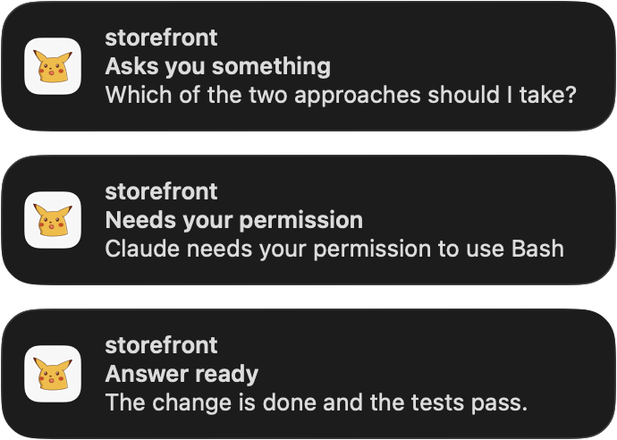

# Notifications

tagents can post a desktop banner when an agent needs you, and a click on the banner takes you to that chat. It is how you find out about a question or a permission prompt while you are in another app. The macOS backend is the one that exists today.



## What raises a banner

| kind | when | default |
|------|------|---------|
| `question` | AskUserQuestion, plan approval, MCP elicitation | on |
| `permission` | a permission prompt | on |
| `turn_done` | the answer is ready, your move | on |
| `cache_expiring` | the prompt cache is about to run out | on |
| `session_end` | the session ended | off |

Each session has one notice at a time. A later notice replaces the earlier one instead of stacking, and a notice that is no longer true is withdrawn.

### Whose notices you get

Notices come only from agents, meaning a Claude session in a tmux pane of its own. Three kinds of session never post one, and no option turns them on:

- **An Agent-tool subagent.** Its `SubagentStop` and its own `Stop` post nothing. A question or a permission prompt it raises blocks the agent that started it, so that one is posted as the agent's.
- **A child session**: a `claude -p` an agent started from its Bash tool, which the dashboard draws under that agent.
- **A headless session** with no pane at all, such as a daemon's `claude -p` turn. It reports wherever it was started from and would leave a click nothing to dock.

## Install

Notifications are a plugin of tagents (`@tagents/notify`), so your config has to name it under `[plugins]` before `tagents notify` is a verb (see [the plugin model](../architecture/overview#the-plugin-model)). It ships inside the managed copy, so two commands do it all:

```sh
tagents plugin add ~/.local/share/tagents/packages/notify
tagents notify install
```

The first writes a `[plugins.notify]` table in `~/.config/tagents/config.toml` (the `config.yaml` that is there instead, when there is no TOML) and prints `added notify → …`.

On macOS this builds the helper app if it is stale, asks for permission, then writes and starts a LaunchAgent that runs the engine in the background. Elsewhere `install` refuses with `no notification backend for <os> yet` and exits 2.

### Allowing notifications

1. `tagents notify install` makes macOS ask whether "tagents" may send notifications: Allow.
2. If you missed the prompt: System Settings → Notifications → tagents → Allow notifications.
3. Choose the Alert Style in System Settings → Notifications → tagents. "Persistent" keeps a notice on screen until you dismiss it, "Temporary" lets it disappear on its own (before macOS 26 they were called "Alerts" and "Banners").
4. Focus and Do Not Disturb hide banners; the notices still land in Notification Center.
5. `tagents notify status` must say `permission: authorized`.

macOS leaves the choice of Alert Style to you. When it is Temporary, `install` and `status` print a hint naming the setting, with a link that opens it. When it is off, the hint says that nothing is shown on screen at all. Nothing is printed when it is Persistent. The hint appears only once the permission is `authorized`: before that, the permission line is what to fix.

::: warning Login Items
macOS may announce a new background item in System Settings → General → Login Items & Extensions. It must stay allowed or launchd will not start the service.
:::

## Clicking a notice

What a click does is the `click` option:

| `click` | what it does |
|---------|--------------|
| `dock` (default) | the same as `enter` in the dashboard list: the viewport shows the chat's window and the terminal goes to the dashboard |
| `goto` | takes the terminal to the agent's own session, window and pane |
| `focus` | only raises the terminal. So does a click on a session with no pane |

`dock` runs `tagents --act open <pane> live <sid> <cwd>`. The `tagents` it runs is the first one on the `PATH` of the shell that ran `install` (the one your dashboard runs; a symlink stays the symlink), else the checkout's own. `TA_NOTIFY_TAGENTS` overrides both. That matters because tagents re-points the global tmux focus hooks at whichever script ran, so a click running another one would move them away from the dashboard's.

## Configuration

Everything is optional, in `<configDir>/plugins/notify.toml`. These are the defaults:

```toml
backend = "auto"      # auto | macos | log | none — auto: macos on darwin, none elsewhere
click = "dock"        # dock: like Enter in the list · goto: the agent's own window · focus: terminal only
# icon = "~/pics/tagents.png"   # a PNG for the notices' icon, unset by default; see below

[events]
question       = { enabled = true,  skip_visible = true }   # AskUserQuestion, plan approval, MCP elicitation
permission     = { enabled = true,  skip_visible = true }   # a permission prompt
turn_done      = { enabled = true,  skip_visible = true }   # the answer is ready, your move
cache_expiring = { enabled = true,  skip_visible = false, after = "50m", ttl = "60m" }
session_end    = { enabled = false, skip_visible = true }
```

A `notify.yaml` that is there instead is still read, with the same keys.

- **Durations** are `<n>s|m|h`, combined like `1h30m`, or a bare number of seconds. `after` must be below `ttl`.
- **`skip_visible`**: when the agent's tmux pane is in some client's current window and that terminal is the frontmost app, the notice is dropped.
- **Reloading**: the file is reloaded when it changes, so there is nothing to restart. An invalid file is logged once per problem and the engine runs on the defaults; `tagents notify status` prints the problems.
- **Symlinked config directories** work in full, such as `~/.config/tagents` pointing into a dotfiles repository. A `notify.toml` that is itself a symlink is seen only when the link is replaced, not when its target is edited.

### The icon

`icon` is an absolute path, a `~/` path, or a path relative to the directory of the options file. Unset, the icon is `notify-icon.png` next to the helper app (`~/Library/Application Support/tagents/`, or next to `TA_NOTIFY_APP`) when that file exists, and the app has no icon of its own otherwise.

- The icon is part of the helper app, so run `tagents notify install` after changing it. `install` rebuilds an app that is stale and prints `icon: <path>` or `icon: none`, as `status` does.
- An `icon` that names no file is a problem line in both, and the app is built without it.
- An icon gives the helper its own bundle id, `io.github.skuratovicha.tagents-notify.i<first 8 hex of the icon's sha256>`, because macOS keeps an app's icon from its first permission request.
- After an icon change, macOS asks once more to allow notifications, and the new registration starts with the Persistent style. The old entry stays in System Settings → Notifications with the old icon, and can be switched off.
- Notification Center may keep showing the old icon: `killall NotificationCenter` clears it. It restarts on its own, and notices already delivered stay.

## Commands

| command | what it does |
|---------|--------------|
| `tagents notify install` | builds the app if stale, asks for permission, writes and starts the LaunchAgent, waits up to 5 s for it to run, prints the status and the steps. Exits 1, naming the cause, when the permission is not `authorized`, the options file is invalid, or the service is not running |
| `tagents notify uninstall [--purge]` | boots the service out, deletes the plist and switches the event stream off; `--purge` deletes the app too |
| `tagents notify status` | platform, backend, app (up to date, stale or missing), icon, permission and alert style, the script a click runs, the LaunchAgent, the stream, the options file and its problems, the service's memory |
| `tagents notify test [--kind <kind>]` | posts one sample notice now; a click docks `$TMUX_PANE` when it is set |
| `tagents notify send [--title <text>] <message…>` | posts a notice with this message now, through the configured backend, ignoring the per-kind switches and `skip_visible`; the title defaults to `tagents`, and a click docks `$TMUX_PANE` when it is set. This is what the `notify_send` tool of the [plugin](./claude-code-plugin) runs |
| `tagents notify run` | the engine in the foreground until it is stopped. This is what the LaunchAgent runs |

## Troubleshooting

Start with `tagents notify status`: it says what is wrong with the permission, the alert style, the script a click runs, the service and the options file.

To see what a click did, read the helper's log. Use the full path, because zsh has a `log` builtin that shadows the tool:

```sh
/usr/bin/log show --last 10m --predicate 'subsystem == "io.github.skuratovicha.tagents-notify"'
```

Each click shows the command it ran, the app it raised, the child's exit status and, when there is one, the child's stderr.

## What it costs

No polling. The service watches the state directory and the options directory with `fs.watch` and keeps at most two timers. Measured on an Apple M4 Pro with macOS 26.7.1, idle:

| | |
|--|--|
| resident memory | 22.5 MiB (about 60 MiB right after start, before the heap settles) |
| CPU | 0.005 % |
| one notice, event to helper exited | 67 ms (median of three) |

## For developers

Adding a backend, the engine's design and the tests are in the [package README](https://github.com/SkuratovichA/tagents/blob/main/packages/notify/README.md).
