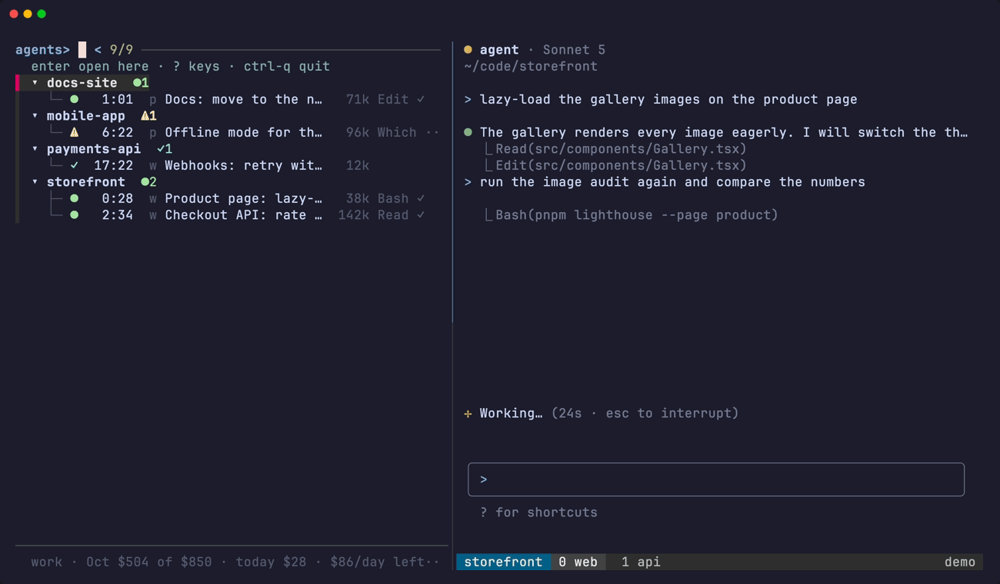

# Resurrect

Close the laptop, reboot, kill the tmux server: your Claude chats come back where they were. Each one returns in its window, resumed on the account it ran on, with the model it was set to and under the window name it had, without you starting anything.



## How it works

tmux-resurrect and tmux-continuum already bring back the sessions, windows, splits, directories and window names. A chat among them comes back as an idle shell in the right directory, because they cannot know which conversation it was.

tagents keeps that missing fact: a snapshot of every live chat keyed by session id (which login, which conversation, which model, which window and pane), and a restore that turns each of those idle shells back into `claude --resume` at the same place.

## Set it up

Two lines in `~/.tmux.conf`, after the tmux-resurrect plugin settings, make both halves happen on their own:

```sh
set -g @resurrect-hook-post-save-layout '~/.local/bin/tagents --resurrect-save'
set -g @resurrect-hook-post-restore-all '~/.local/bin/tagents --resurrect --auto'
```

- The first captures on every tmux-resurrect save.
- The second restores once continuum has put the layout back after a start.
- `tmux source-file ~/.tmux.conf` picks them up.

`--auto` has no terminal, so its report goes to `$STATE_DIR/resurrect.log` (its last 2000 lines are kept) and the status line says `tagents: resurrected N agents, K skipped`. `$STATE_DIR` is `~/.claude/agent-state/` by default.

## What comes back

- **Every chat with a state record**, whether tagents started it or you typed `claude` by hand, because the state hook runs in every Claude.
- **At the same `session:window.pane`** when tmux-resurrect left an idle shell there. In a new window of that session when that pane is busy or gone, and in a new session of that name when even the session is gone. A pane running anything but a shell is never touched, and nothing depends on tmux-resurrect having run: on a bare server the restore creates what is missing.
- **On the login it ran on**, never the account rules and never a dialog, since a hook has no terminal to ask in. A record from before the account field existed is resumed on the default login, and the report says so.
- **With its model** (the status line records a `/model` switch too) and any `--effort` it was started with. `--resume` brings the permission mode back by itself.
- **Under its window name.** A name tagents gave the window keeps following the agent, and one you typed stays yours.
- **The dashboard**, when it was up. The cockpit is brought back with its viewport on the window the snapshot recorded (else the window of the first chat restored), a leftover cockpit session is rebuilt first, and the idle shells tmux-resurrect brought back where the list stood are closed. Every chat comes back in the window its pane was in; a chat that was joined into another window comes back in its home session.
- **The notes editor** of every chat whose editor was on screen. One that was hidden stays hidden. The editors tmux-resurrect brought back, beside a chat in its own window or left in `ta-notes` by an older version, belong to no chat and hold their files open, so the next `prefix C-t` would run into a swap-file warning; they are closed first.
- **Nothing twice.** A chat already running, by session id, is skipped, and so is one whose transcript is gone from its login. A directory that no longer exists is resumed in `$HOME`, and the report says so.

The hook's `--auto` restores once per tmux server, and only within the server's first 5 minutes. tmux-resurrect fires the same hook on a `prefix + C-r` in a server that has been up for hours, where a restore would bring back every chat ended since the boot and replace idle shells that are yours now. `tagents --resurrect` by hand is the way to run it again.

## Before a planned reboot

1. `prefix + C-s`: tmux-resurrect saves, and its hook takes the tagents snapshot at the same instant. Or `tagents --resurrect-save`.
2. Optional: `tagents --resurrect --dry-run --from latest` lists what would come back.
3. Reboot, open a terminal, start tmux as usual. Continuum restores the layout, the hook runs `tagents --resurrect --auto`, the status line says how many agents came back, and the line per chat is in `~/.claude/agent-state/resurrect.log`.
4. If auto-restore is off or the hook did not fire: `tagents --resurrect` picks the newest snapshot from before the boot, and `tagents --resurrect --dry-run` shows it first.

## Configuration

The `resurrect:` section of the tagents config steers it. Every key is optional, and `tagents --check` names a value it cannot read:

```yaml
resurrect:
  auto: true       # restore when tmux-resurrect's post-restore-all hook fires (default true)
  every: 300       # seconds between status-bar captures; 0 turns the periodic capture off
  notes: reopen    # reopen the tnotes editor of every restored chat that had it on screen: reopen | off
```

`auto: false` makes the hook do nothing at all; `tagents --resurrect` by hand still works.

## The snapshots

Snapshots are `$STATE_DIR/resurrect/<epoch>.tsv`. One is written:

- on every tmux-resurrect save (every 15 minutes with continuum, and on `prefix + C-s`),
- a few seconds after every launch or kill by tagents,
- and by the status bar every `resurrect.every` seconds.

One that says exactly what the newest already says is not written again. The newest 50 are kept, plus the one a restore on this server would read however old it is.

**The restore uses the newest snapshot written before this tmux server started**, so the captures taken after the boot can never shadow the set that was running before it. Those later captures are not harmless all the same: a capture of a server nothing has been restored on yet says "no chats", and a second server start soon after (a `kill-server`, a crash) would pick exactly that one. So while `resurrect.auto` is on:

- a new server is not captured until the hook has restored it, or until it is 5 minutes old if the hook never fires. This applies only when `@resurrect-hook-post-restore-all` runs `tagents --resurrect`: without that line nothing will restore the server, so it is captured from the start. A `tagents --resurrect-save` typed during the wait saves nothing and says why,
- nothing is captured while a restore is placing chats,
- and the restore takes a snapshot of its own 15 seconds after it is done, once the chats it resumed have written their records.

`tagents --resurrect-rows` prints that snapshot's raw rows, and `tagents --resurrect-rows latest` the newest one of all.

## What does not come back

- **A chat's scrollback.** tmux-resurrect restores it and the resume replaces it, but Claude redraws the conversation anyway.
- **An `/effort` chosen inside a session** is recorded nowhere; only an `--effort` on the command line is replayed. `/model` is covered.
- **A Claude on a login without the state hook** has no record, so it is not captured.
- **Headless sessions** (`s-*`) have no pane to go back into and are not resurrected.
- **A shell under a resumed chat.** Its pane runs `claude --resume` itself, like a chat started from the dashboard, so `/exit` closes the pane instead of dropping back to a prompt.
- **A chat started by hand in the last `resurrect.every` seconds** before an unplanned crash. Launches by tagents are captured a few seconds after they start, and the procedure above closes the gap for a planned reboot.
